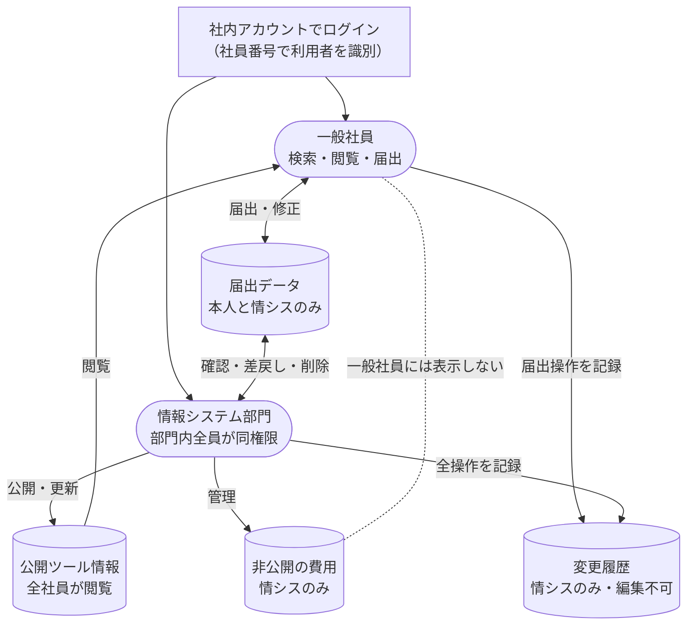

# 社内ツール案内アプリ 要件定義書

> 本書の社名・人物・データはすべて架空のものです。

## 0. 結論（このアプリで実現すること）

**「やりたいこと」から社内の最適なツールを逆引きできるようにし、ツール選びの誤りによる後からの移行（仕組みづくり・データ移行）の手戻りを防ぐ。**

---

## 1. 目的・困りごと

### 1-1. 要望（最初に出てきた声）
社内にシステムやツールが多く、何がどう使えるのかわからない。何のシステムがあり、何に使われているかを簡単に把握したい。

### 1-2. なぜなぜ分析

| 段階 | 問い | 答え |
|---|---|---|
| なぜ1 | 把握できないと、どんな場面で困るか | 「こういうことをしたい」と相談されて案内したツールより、適切なツールが後から見つかった |
| なぜ2 | なぜ適切なツールにたどり着けなかったか | ①そのツールの**存在を知らなかった**　②知っていたが、その**用途に使えると知らなかった** |
| なぜ3 | 後から判明して何が困ったか | 結局そのツールへ移行することになり、仕組みからデータまで作り直す**大きな手戻り**が発生した |

### 1-3. 要求（本当の目的）
**相談を受けた時点で最適なツールを選べるようにし、後からの移行という手戻りを防ぐ。**

そのために必要なこと：
- 社内のツールを漏れなく知れること（「存在を知らない」への対策）
- 「やりたいこと」から合うツールを逆引きできること（「用途を知らない」への対策）
- 新しく導入されたツールが一覧から漏れないこと

---

## 2. 使う人（ペルソナ）

### ペルソナA：案内する側（各部署のIT窓口担当）
- **所属**：管理部門、社歴8年。本業のかたわら部署内のIT相談に対応
- **状況**：週に数件「こんなことをしたい」と相談を受けるが、自分が知っている範囲のツールで答えている
- **困りごと**：他部署で使われているツールや、知っているツールの別の使い道までは把握できていない
- **望むこと**：相談を受けたその場で候補を比較し、自信を持って案内したい

### ペルソナB：相談する側（一般社員）
- **所属**：営業部門、社歴2年。ITには詳しくない
- **状況**：業務を効率化したいとき、何を使えばよいかわからず、窓口担当に聞くか手元の表計算ソフトで済ませている
- **困りごと**：誰に聞けばよいか、何と調べればよいかもわからない
- **望むこと**：システム名を知らなくても、「やりたいこと」の言葉で候補を見つけたい

---

## 3. 機能

| No. | 機能 | 内容 | 主な利用者 |
|---|---|---|---|
| F1 | やりたいことから探す | 「日程を調整したい」などの言葉で検索し、候補ツールを表示する | ペルソナA・B |
| F2 | カテゴリから探す | 「申請・承認」「情報共有」「データ集計」などの分類から一覧する | ペルソナA・B |
| F3 | ツール詳細を見る | 概要、できること、向いている／向いていない用途、利用中の部署、利用申請の方法、問い合わせ窓口、契約情報を表示する | ペルソナA・B |
| F4 | 候補を比較する | 似たツールを2〜3個並べて違いを確認する | ペルソナA |
| F5 | 新規ツールを届け出る | ツールを導入した部署の社員が届け出る（一般社員なら誰でも可）。入力画面に「個人名・取引先名・契約書の本文は書かない」旨の注意書きを表示する | 一般社員 |
| F6 | 届出を確認・公開する | 届出内容を確認・整えたうえで一覧に公開する。確認時に個人情報や機密が書かれていないかもチェックする。確認前は届出者本人と情報システム部門以外に表示しない | 情報システム部門 |
| F7 | 届出を差し戻す | 内容に不備がある届出を、理由を付けて届出者に差し戻す | 情報システム部門 |
| F8 | 差し戻された届出を修正する | 届出者本人が差し戻し理由を見て修正し、再提出する | 一般社員（届出者本人） |
| F9 | 届出を削除する | 不要になった届出を手動で削除する | 情報システム部門 |
| F10 | ツール情報を更新する | 内容の追加・修正・費用公開区分の設定を行う | 情報システム部門 |
| F11 | 変更履歴を見る | ツール情報・届出について、誰がいつ何を変更・削除したかを確認する | 情報システム部門 |

---

## 4. 扱うデータ

| 区分 | 項目 | 架空の例 |
|---|---|---|
| 基本情報 | ツール名 | ツールA |
| | カテゴリ | 情報共有 |
| | 概要 | 部署内の資料や連絡事項を共有するツール |
| | できること | ファイル共有、掲示板、簡易アンケート |
| | 向いている用途 | 部署内の情報共有、少人数のアンケート |
| | 向いていない用途 | 大量データの集計、社外との共有 |
| 検索用 | キーワード | 情報共有、掲示板、アンケート、資料置き場 |
| 利用状況 | 利用中の部署 | 営業部、管理部 |
| | 利用申請の方法 | 所定の申請フォームから申請 |
| | 問い合わせ窓口 | 情報システム部門（部署名のみ。個人名は載せない） |
| 契約情報 | 費用 | 月額 ○○円／1ライセンス |
| | 契約期間 | 1年（毎年更新） |
| | ライセンス数 | 50（うち使用中 42） |
| | 費用公開区分 | 公開／非公開（判断基準は5章） |
| 届出情報 | 届出者の社員番号 | 000000（架空） |
| | 届出者の部署 | 営業部 |
| | 届出日 | 20XX年X月X日 |
| | 確認状況 | 未確認／差し戻し／公開済み |
| | 差し戻し理由 | 「向いている用途」の記入をお願いします |
| 変更履歴 | 変更日時 | 20XX年X月X日 10:00 |
| | 変更者の社員番号 | 000001（架空） |
| | 対象 | ツールA の基本情報／届出No.12 |
| | 操作 | 追加／修正／差し戻し／公開／削除 |
| | 変更内容 | 「できること」に簡易アンケートを追記 |

- 社員番号は利用者の識別にのみ使い、一般社員向けの画面には表示しない
- 口座番号やマイナンバーなど、識別に不要な個人情報は持たない

---

## 5. 誰が何を見られるか

| 情報 | 一般社員 | 情報システム部門 |
|---|---|---|
| 基本情報・利用状況 | 閲覧 | 閲覧・編集 |
| 契約期間・ライセンス数 | 閲覧 | 閲覧・編集 |
| 費用（公開区分＝公開） | 閲覧 | 閲覧・編集 |
| 費用（公開区分＝非公開） | **見えない** | 閲覧・編集 |
| 新規ツールの届出 | 登録・**自分の届出のみ**閲覧・差し戻し分の修正 | 閲覧・確認・差し戻し・公開・削除 |
| 他人の届出 | **見えない** | 閲覧 |
| 未公開のツール情報 | **見えない**（自分の届出分のみ閲覧） | 閲覧・編集 |
| 変更履歴 | **見えない** | 閲覧 |

- 利用者は社内アカウントでのログインにより識別し、アカウントに紐づく社員番号で「本人の届出」かを判定する
- 情報システム部門の権限は部門内の全員に付与する（部門内で区分しない）。そのかわり、すべての変更・削除を変更履歴に残す
- 情報システム部門の権限の付与・削除は、組織変更のタイミングで行う
- 社員番号・氏名・部署は、既存の社内の社員情報と連携して取得する（アプリが保持するのはこの3項目のみ）

**費用公開区分の判断基準**（情報システム部門が設定する）
- 基幹システムの費用は「非公開」とする
- 月額ライセンス型ツールの費用は原則「公開」とする
- ただし、ツール提供元との契約に秘密保持の条項があり、価格の社内公開が認められていない場合は「非公開」とする
- 判断に迷う場合は契約内容を確認し、不明なら所属長→情報システム部の責任者の順に相談する

### データの流れ図

- 実線の矢印はデータの流れ、点線は「流れない（表示しない）」ことを表す
- 角丸の箱は人、円柱はデータの保管場所を表す

---

## 6. 非機能要件

| 観点 | 要件 |
|---|---|
| 利用環境 | 社内標準のWindows PC＋Edgeで動作すること。iPad・スマートフォン対応は不要 |
| 本人確認 | 社内アカウントでログインし、アカウントに紐づく社員番号で利用者を識別すること（社員番号の手入力だけで本人とみなさない）。社員情報は既存の社内の社員情報と連携して取得すること |
| データの保管 | 社内データが会社の管理外へ出ない構成とすること（承認外の外部サービスへの送信・保存をしない） |
| 変更履歴 | ツール情報・届出の追加・修正・差し戻し・公開・削除をすべて記録し、記録そのものは編集・削除できないこと。例外として、個人情報が混入した場合に限り、情報システム部門の責任者が該当する履歴を削除できる。その際も「いつ・誰が・何の理由で削除したか」は記録に残すこと |
| 使いやすさ | ITに詳しくない人でも、説明なしで検索から詳細表示までたどり着けること |
| 応答速度 | 検索結果が数秒以内に表示されること |
| 保守 | 情報システム部門が、プログラム修正なしでツール情報を追加・更新できること |

---

## 7. 作らないもの

- 利用申請の手続き（申請方法の案内まで。申請・承認処理は行わない）
- ライセンスの割り当て管理（誰がどのライセンスを使っているかの管理）
- 契約・支払いの手続き（情報の表示のみ）
- 各ツールへのログイン連携
- 各ツールの詳しい操作マニュアル（既存マニュアルの所在案内にとどめる）
- iPad・スマートフォン対応

---

## 8. 完了の条件

「社内で使い始めてよい」と判断するための条件。**判定は情報システム部門が行う。**

| No. | 観点 | 条件 |
|---|---|---|
| C1 | 網羅 | 情報システム部門が把握している社内ツールが全件登録されている |
| C2 | 逆引き（最重要） | 過去の相談事例（例：「部署内アンケートを集計したい」）を検索すると、適切なツールが候補に表示される |
| C3 | 届出 | 一般社員の届出から、情報システム部門の確認・公開までの流れが動作する |
| C4 | 権限 | 非公開の費用・未公開のツール情報・他人の届出・変更履歴が一般社員に表示されない |
| C4-2 | 差し戻し・削除 | 差し戻した届出を届出者本人が修正・再提出でき、不要な届出を情報システム部門が削除できる |
| C4-3 | 変更履歴 | 追加・修正・差し戻し・公開・削除の操作が、操作者の社員番号と日時つきで記録されている |
| C5 | 使いやすさ | 情報システム部門の担当者がペルソナBの立場を想定し、説明なしで目的のツールの詳細までたどり着ける |

---

## 9. 補足・今後決めること

- **使いやすさの確認方法**：判定者が情報システム部門のみのため、C5は「IT知識のある人が想定して試す」確認にとどまる。公開後に一般社員から「探したが見つからなかった」声を集め、キーワードや分類を改善する運用を推奨する
- **登録情報の鮮度**：情報が古くなると「用途を知らない」問題が再発するため、定期的な見直し（例：半期ごと）の時期と担当を決める
- **作る仕組み（基盤）の選定**：届出・権限の出し分けがあるため、複数人でデータを共有できる社内承認済みの基盤上に構築する必要がある。具体的な基盤は情報システム部門と相談して決める
- **保守体制**：アプリは運用部門（本件では情報システム部門）で維持・保守する前提とする
- **変更履歴の保存期間**：履歴をいつまで残すか（例：3年）は未決。運用開始前に決める
- **異動・退職時の扱い**：届出者が異動・退職した場合、その人の届出（差し戻し中のものを含む）を誰が引き継ぐかは未決
- **組織変更以外の時期の異動・退職**：権限の付け外しは組織変更のタイミングと決めたが、期中の異動や退職があった場合に権限を即時に外すかは要確認（推奨：退職・期中異動は随時外す）
- **社員情報との連携方法**：既存の社内の社員情報とどの方法で連携するか、部署情報がいつ反映されるかは、作る基盤と合わせて決める
- **データの書き出し（出力）の扱い**：一覧のファイル書き出しや印刷を可能にするかを決める。可能にする場合は、非公開の費用など権限で隠している項目を含めない（「書き出し機能は作らない」とする場合は7章に追記する）
